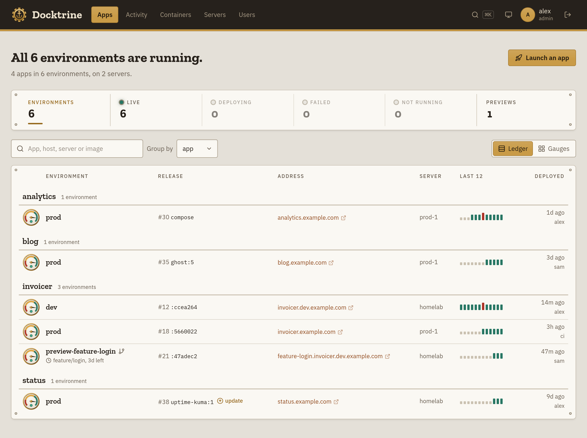
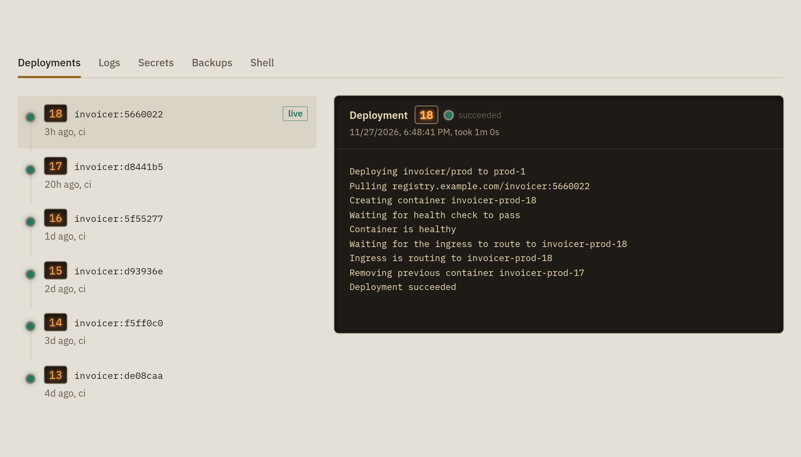
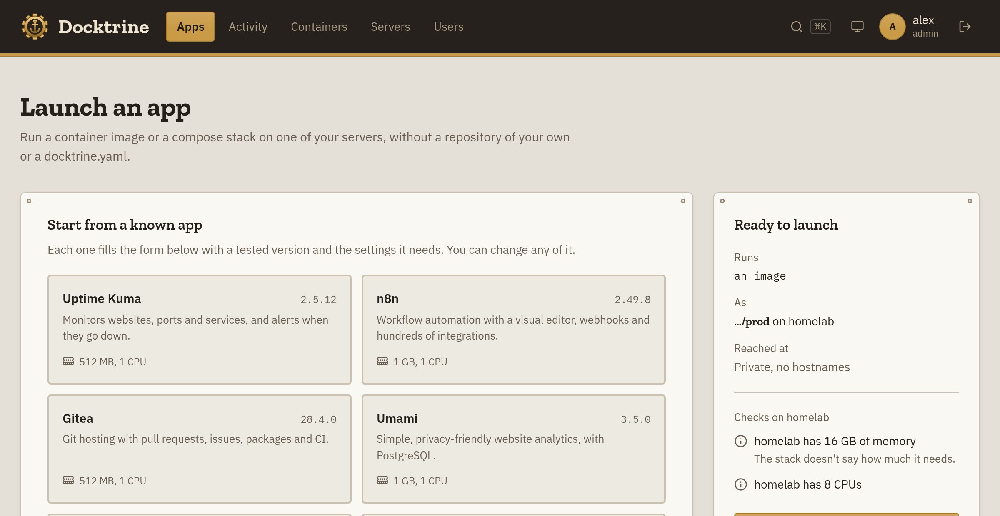
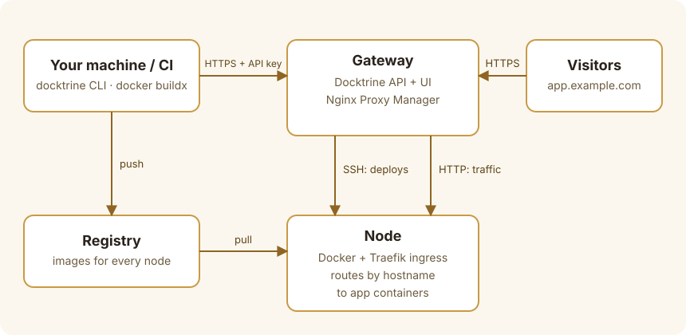

<div align="center">


<h1>Docktrine</h1>

<p>Deploy apps to your own Docker servers from the command line.</p>

[](LICENSE)


[Quick start](#quick-start) · [docktrine.yaml](docs/manifest.md) · [CLI](docs/cli.md) · [Gateway setup](deploy/README.md)

</div>

Describe an app in a `docktrine.yaml`, and one command builds its image, pushes
it to your registry, starts it on the right server and points its hostnames at
it through Nginx Proxy Manager.

```sh
docktrine deploy dev           # build, push, deploy, route hostnames
docktrine deploy preview       # a temporary copy of the current branch
docktrine logs prod -f
docktrine rollback prod
```

<p align="center">
  <picture>
    <source media="(prefers-color-scheme: dark)" srcset="docs/assets/screenshots/apps-dark.png">
    
  </picture>
</p>

## Features

- **Zero-downtime deploys** for single-image apps: if the new container
  isn't healthy and routed, the old one keeps serving.
  [Compose apps](docs/manifest.md#compose-apps) restart changed services.
- **Preview environments** for any branch, with an optional expiry.
- **Encrypted secrets** that never live in your repository.
- **Volume backups** before setup commands, or before every upgrade if you
  choose, with [restore](docs/operations.md#backups).
- **App launcher** for Sentry, Plausible, Uptime Kuma and
  [more](docs/launching.md), or any container image or compose file.
- **Update checks** for new commits and image tags.
- **Web UI** with history, logs, rollbacks, user roles, and logged shells
  into containers and servers.

### Deployment history and logs

<p align="center">
  <picture>
    <source media="(prefers-color-scheme: dark)" srcset="docs/assets/screenshots/environment-dark.png">
    
  </picture>
</p>

### Launch an app

<p align="center">
  <picture>
    <source media="(prefers-color-scheme: dark)" srcset="docs/assets/screenshots/launch-dark.png">
    
  </picture>
</p>

## How it works

<p align="center">
  
</p>

A node reached over SSH needs only Docker and an SSH user: no agent and no
exposed Docker port. Each node runs one Traefik ingress that routes by hostname,
so adding an app never needs a new tunnel or port.
[More on how deploys work](docs/operations.md#how-deploys-work).

## Quick start

You need a Docktrine server on your gateway ([setup guide](deploy/README.md)),
and Go 1.23+ and Docker with `buildx` on your machine.

1. **Install the CLI.** This builds macOS and Linux binaries into `dist/`; put
   yours on your `PATH` as `docktrine`.

   ```sh
   git clone https://github.com/Zeptile/docktrine.git && cd docktrine
   ./build.sh cli
   sudo install dist/docktrine-linux-amd64 /usr/local/bin/docktrine  # pick your platform
   ```

2. **Connect to your server.** Create an API key on your Account page in the web
   UI (ask an admin for an invite if you can't sign in).

   ```sh
   export DOCKTRINE_API_URL=https://docktrine.example.com
   export DOCKTRINE_API_KEY=dkt_...
   ```

3. **Log in to your registry** with `docker login <registry>`.

4. **Write a manifest.** In your app's repository, run `docktrine init`, then
   set the node and hostnames. A small one looks like this:

   ```yaml
   app: invoicer
   build:
     dockerfile: Dockerfile
   environments:
     prod:
       node: prd1                      # a server name in Docktrine
       hostnames: [invoicer.example.com]
       port: 8080
       secrets: [DATABASE_URL]
       healthcheck: /healthz
   ```

5. **Set secrets and deploy.**

   ```sh
   docktrine secrets set prod DATABASE_URL=postgres://...
   docktrine deploy prod
   ```

## Documentation

| Guide | What's in it |
| --- | --- |
| [docktrine.yaml](docs/manifest.md) | Every field, images, Compose apps, previews, secrets |
| [Launching apps](docs/launching.md) | Known apps, Git stacks, preflight checks, setup commands, updates |
| [Operations](docs/operations.md) | How deploys work, backups and restores, shells |
| [CLI reference](docs/cli.md) | Commands and their main flags |
| [Gateway setup](deploy/README.md) | Installing the server, users and API keys |
| [Server configuration](docs/server.md) | Environment variables |
| [Development](docs/development.md) | Running locally, tests, project layout |

## License

[MIT](LICENSE)
