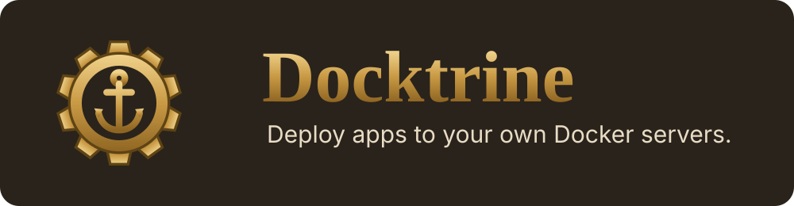

<div align="center">



[](LICENSE)


</div>

Docktrine takes an app from your repository to a running, routed container on
your own servers. Describe the app in a `docktrine.yaml`, then:

```sh
docktrine deploy prod          # build, push, start, route hostnames
docktrine deploy preview       # a temporary copy of the current branch
docktrine logs prod -f
docktrine rollback prod
```

Deploys are zero-downtime: the old container keeps serving until the new one
passes its health check. A web UI shows every app, its history and logs, and
lets you redeploy, roll back, manage secrets, backups and nodes, and open a
shell.

## Features

- **Simple manifest.** One `docktrine.yaml` per repository covers images,
  Compose stacks, environments, hostnames, volumes and secrets.
- **Zero-downtime deploys.** A failed deploy leaves the previous version running.
- **Preview environments** for any branch, removed automatically after a TTL.
- **Encrypted secrets** that never live in your repository.
- **Volume backups** before setup commands and upgrades, with restore.
- **Launch third-party apps** such as Sentry, Plausible or Uptime Kuma from a
  known-app catalog, a container image, or any public Git repository.
- **Update checks** for new commits and image tags, with one-click updates.
- **Audited shells** in containers or on servers, from the browser.

## How it fits together

<p align="center">
  
</p>

Each node needs only Docker and an SSH user: no agent and no exposed Docker
port. The gateway's Nginx Proxy Manager sends every hostname to the node's one
Traefik ingress, which routes it to the right container. Details are in
[Operations](docs/operations.md).

## Quick start

You need a Docktrine server on your gateway. See
[deploy/README.md](deploy/README.md) for setup.

1. **Install the CLI.** Run `./build.sh cli`, which builds macOS and Linux
   binaries into `dist/`. Put yours on your `PATH` as `docktrine`.
2. **Connect it** with an API key from `docktrine keys create <your-name>`:

   ```sh
   export DOCKTRINE_API_URL=https://docktrine.zeptile.software
   export DOCKTRINE_API_KEY=dkt_...
   ```

3. **Log in to your registry** with `docker login <registry>`.
4. **Write a manifest.** In a repository, run `docktrine init`, then review
   the nodes and hostnames it writes.
5. **Deploy.** Run `docktrine deploy dev`.

A minimal manifest:

```yaml
app: invoicer
build:
  dockerfile: Dockerfile
environments:
  prod:
    node: prd1-tor
    hostnames: [invoicer.zeptile.software]
    port: 8080
    secrets: [DATABASE_URL]
    healthcheck: /healthz
```

## Documentation

| Guide | What's in it |
| --- | --- |
| [docktrine.yaml](docs/manifest.md) | Every field, images, Compose apps, previews, secrets |
| [Launching apps](docs/launching.md) | Known apps, Git stacks, generated secrets, preflight checks, setup commands, updates |
| [Operations](docs/operations.md) | How deploys work, backups and restores, shells |
| [CLI reference](docs/cli.md) | Every command and flag |
| [Server configuration](docs/server.md) | Environment variables for the server |
| [Development](docs/development.md) | Running locally, tests, project layout |
| [Gateway setup](deploy/README.md) | Installing Docktrine on your gateway, users and API keys |

## License

[MIT](LICENSE)
